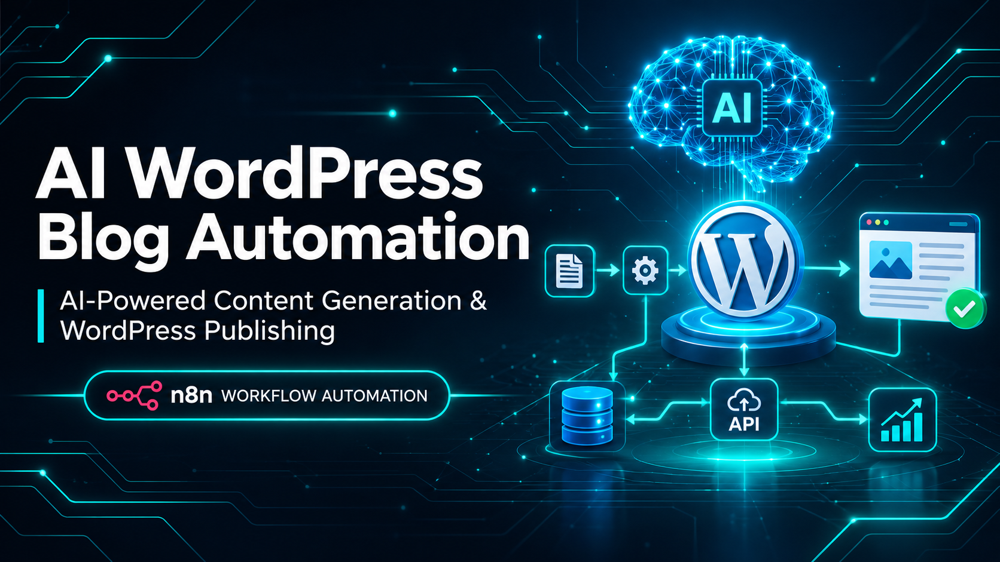
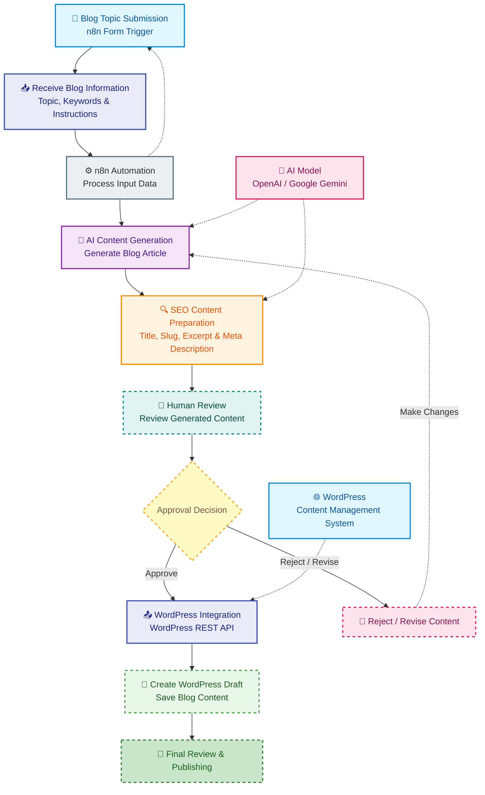
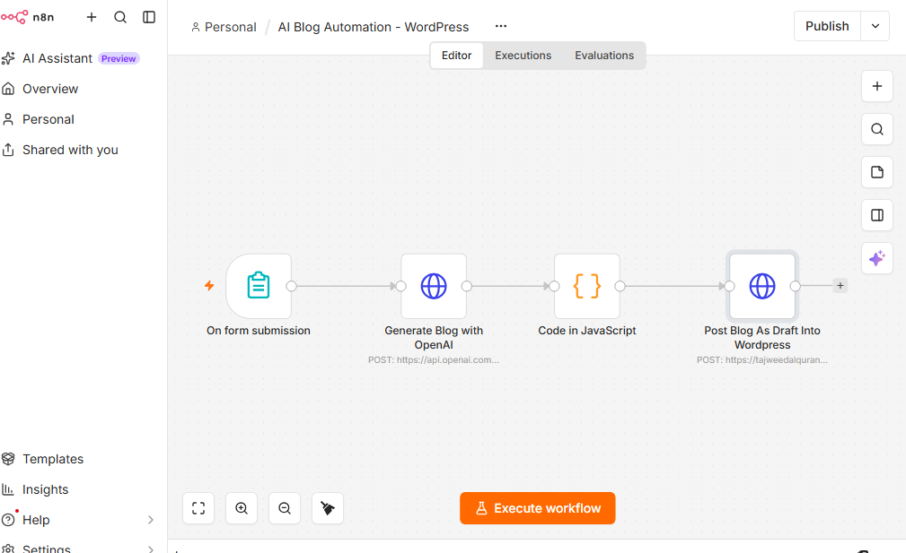

# 📝 AI WordPress Blog Automation

### AI-Powered Content Generation & WordPress Draft Publishing with n8n

An AI-powered content automation system that generates structured, SEO-friendly blog articles and sends them to WordPress as drafts for human review.

---

## 📌 Project Overview

This project automates the blog content creation process using n8n, AI models, and the WordPress REST API.

The workflow receives a blog topic, generates a complete article using AI, prepares SEO information, and creates a WordPress draft for review before publication.

**Project Type:** AI Content Automation  
**Project Status:** Completed  
**Platform:** n8n  
**Purpose:** Automate blog writing and WordPress content preparation.

---

## 🎯 Business Problem

Managing a business blog involves several repetitive tasks:

- Researching and selecting blog topics.
- Writing high-quality articles.
- Creating SEO-friendly titles.
- Writing meta descriptions and excerpts.
- Organizing content with proper headings.
- Preparing articles in WordPress.
- Reviewing content before publication.

Performing these tasks manually takes time and reduces productivity.

## 💡 My Automation Solution

I developed an automated workflow using n8n and AI to simplify the entire blog content preparation process.

The system:

1. Receives a blog topic through a form.
2. Sends the topic to an AI model.
3. Generates a structured blog article.
4. Prepares SEO information.
5. Organizes the article with appropriate headings.
6. Supports human review and approval.
7. Creates the approved content as a WordPress draft.

---

## ⚙️ Workflow Architecture

The following diagram illustrates the complete AI WordPress Blog Automation workflow, from blog topic submission to AI-powered content generation, SEO preparation, human review, and WordPress draft creation.

---

## 🔄 Workflow Execution

### Step 1 — Blog Topic Submission
The user submits a blog topic and instructions through an n8n form.

### Step 2 — Input Processing
n8n receives and processes the submitted blog information.

### Step 3 — AI Content Generation
The AI model generates a structured blog article based on the provided topic and instructions.

### Step 4 — SEO Content Preparation
The workflow prepares SEO-related information, including the title, slug, excerpt, and meta description.

### Step 5 — Human Review
The generated article is reviewed to ensure content quality and accuracy.

### Step 6 — Approval Decision
The content moves through an approval decision stage.

- **Approve:** Continue to WordPress integration.
- **Reject / Revise:** Return the content for changes.

### Step 7 — WordPress Integration
n8n connects with WordPress through the WordPress REST API.

### Step 8 — Draft Creation
The approved content is saved as a WordPress draft.

### Step 9 — Final Review & Publishing
The administrator performs the final review and publishes the blog post when ready.

---

## 🎯 Business Benefits

- Automates repetitive blog content preparation.
- Reduces manual content creation work.
- Generates structured SEO-friendly articles.
- Integrates AI with WordPress.
- Maintains human control over publishing.
- Improves content management efficiency.

## ✨ Key Features

- **AI Blog Generation:** Automatically generates blog articles from user-provided topics.
- **SEO Content Preparation:** Generates titles, slugs, meta descriptions, and excerpts.
- **Structured Articles:** Organizes content using appropriate H1, H2, and H3 headings.
- **WordPress Integration:** Connects n8n with WordPress through its REST API.
- **Human Approval:** Allows content review before publishing.
- **Draft Creation:** Saves generated articles in WordPress as drafts.

---

## 🛠️ Technologies Used

| Technology | Purpose |
|---|---|
| n8n | Workflow automation |
| OpenAI / Google Gemini | AI content generation |
| WordPress | Content management |
| WordPress REST API | WordPress integration |
| HTTP Request | API communication |
| WordPress Application Password | Authentication |

---

## 📸 Workflow Screenshots

1. Complete overview of ai blog writing workflow.

2. a form submission where you write topic, and keywords etc.
.png)

4. Ai agent generate content to post your website.
.png)

5. Proper SEO type content with title, slug and content.
.png)

6. Content save as a draft in wordpress to approve or reject.
.png)

7. Complete workflow execute successfully.
.png)

---

## 📚 Project Documentation

Read the complete [Project Walkthrough](https://github.com/syedaliabbashamdani/ai-wordpress-blog-automation/blob/f5db9dce4a3b01fda0789e699fc97a01a684ed2b/documentation/PROJECT-WALKTHROUGH.md)
to understand the workflow architecture, individual steps,
technologies, and business applications.

## 🧠 Skills Demonstrated

- n8n Workflow Development
- AI Integration
- Prompt Engineering
- SEO Content Generation
- WordPress REST API
- HTTP Request
- API Authentication
- Workflow Automation
- Human-in-the-Loop Automation

---

## 💼 Want This Automation for Your Business?

I can build customized AI-powered content automation systems that connect your AI tools with WordPress and other business applications.

**Available for freelance AI automation projects.**

**Developer:** Syed Ali Abbas  
**GitHub:** https://github.com/syedaliabbashamdani

**Portfolio:** Add your Notion portfolio link here  
**Fiverr:** Add your Fiverr profile link here
